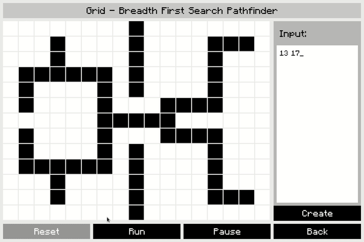
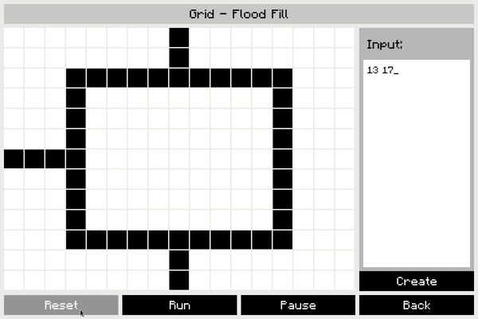
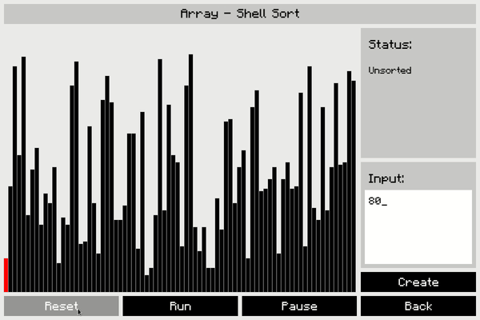
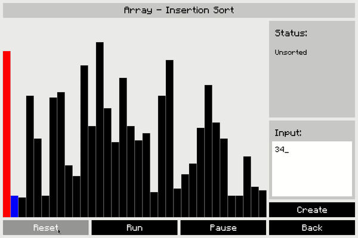
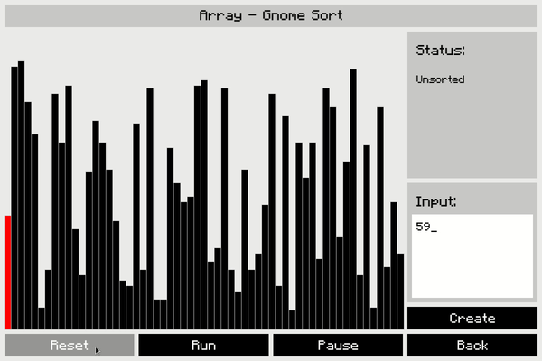
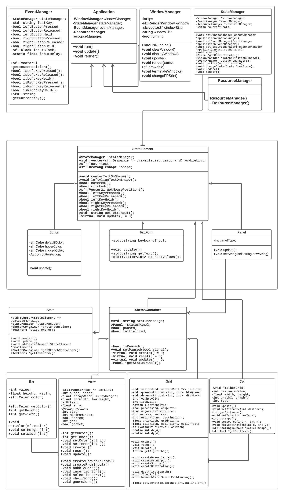

<div align="center">

  <h1>AlgoSketch</h1>

  <p>
    <strong>Turning abstract algorithms into visual experiences.</strong>
  </p>

  <p>
    An interactive desktop application exploring sorting algorithms,
    graph traversal, spatial search, and data structures through
    real-time visualization powered by C++ and SFML.
  </p>

  [](https://isocpp.org/)
  [](https://www.sfml-dev.org/)
  [](https://cmake.org/)
  [](#supported-algorithms)
  [](#getting-started)

  <p>
    <a href="#overview">Overview</a> ·
    <a href="#algorithm-showcase">Showcase</a> ·
    <a href="#supported-algorithms">Algorithms</a> ·
    <a href="#architecture">Architecture</a> ·
    <a href="#getting-started">Getting Started</a>
  </p>

  

  <sub>
    Exploring computational processes through interactive,
    incremental algorithm visualization.
  </sub>

</div>

## Overview

AlgoSketch is a native desktop application designed to make
algorithms and data structures more intuitive through interactive
computer graphics.

The application transforms computational operations into visual
experiences, allowing users to observe how algorithms compare,
rearrange, explore, and navigate data over time.

Rather than presenting algorithms exclusively through source code
or mathematical descriptions, AlgoSketch exposes their intermediate
states through animated arrays and interactive two-dimensional grids.

Built with C++ and SFML, the project combines algorithmic reasoning,
object-oriented programming, event-driven application architecture,
and real-time graphical rendering.

Its primary areas of exploration include:

- Sorting algorithms and computational complexity.
- Graph traversal and spatial search.
- Interactive data structure visualization.
- Incremental algorithm execution.
- Object-oriented software architecture.
- Native desktop graphics and event handling.

## Features

| Feature | Description |
| :--- | :--- |
| **Algorithm Visualization** | Eight implemented algorithms across sorting and grid exploration. |
| **Interactive Arrays** | Generate arrays with configurable sizes and observe sorting operations. |
| **Custom Grids** | Construct two-dimensional environments with configurable dimensions. |
| **Spatial Exploration** | Visualize flood fill, depth-first search, and breadth-first search. |
| **Obstacle Editing** | Modify grid environments before algorithm execution. |
| **Path Reconstruction** | Visualize routes computed through breadth-first search. |
| **Execution Controls** | Run, pause, resume, and reset algorithm visualizations. |
| **Adjustable Speed** | Modify visualization timing through mouse-wheel interaction. |
| **Visual Feedback** | Highlight active elements, comparisons, distances, and traversal states. |
| **Native Rendering** | Render interactive graphical environments using SFML. |

## Algorithm Showcase

### Spatial Search and Graph Traversal

Grid-based algorithms provide a visual representation of spatial
connectivity, graph exploration, and route computation.

Each grid cell represents a vertex, while valid transitions between
adjacent cells represent connections within an implicit graph.

<table>
  <tr>
    <td align="center" width="50%">
      <strong>Flood Fill</strong>
    </td>
    <td align="center" width="50%">
      <strong>BFS Pathfinding</strong>
    </td>
  </tr>
  <tr>
    <td>
      
    </td>
    <td>
      
    </td>
  </tr>
  <tr>
    <td align="center">
      <sub>Connected region exploration</sub>
    </td>
    <td align="center">
      <sub>Distance-based shortest-path search</sub>
    </td>
  </tr>
</table>

### Sorting Algorithms

Array visualization represents numerical values through vertical
bars, exposing the comparisons, exchanges, and intermediate
configurations produced by sorting algorithms.

<div align="center">

  

  <sub>
    <strong>Shell Sort</strong> — incremental ordering through
    decreasing comparison gaps.
  </sub>

</div>

<br />

<table>
  <tr>
    <td align="center" width="50%">
      <strong>Insertion Sort</strong>
    </td>
    <td align="center" width="50%">
      <strong>Gnome Sort</strong>
    </td>
  </tr>
  <tr>
    <td>
      
    </td>
    <td>
      
    </td>
  </tr>
  <tr>
    <td align="center">
      <sub>Progressive construction of a sorted sequence</sub>
    </td>
    <td align="center">
      <sub>Local comparisons and adjacent exchanges</sub>
    </td>
  </tr>
</table>

## Supported Algorithms

AlgoSketch currently implements eight algorithms organized
around two principal data structures: arrays and grids.

### Sorting

| Algorithm | Best Case | Average Case | Worst Case |
| :--- | :---: | :---: | :---: |
| Bubble Sort | O(n)¹ | O(n²) | O(n²) |
| Selection Sort | O(n²) | O(n²) | O(n²) |
| Insertion Sort | O(n) | O(n²) | O(n²) |
| Shell Sort | Gap-dependent | Gap-dependent | Gap-dependent |
| Gnome Sort | O(n) | O(n²) | O(n²) |

¹ The linear best case for Bubble Sort assumes an early-exit optimization.

The table describes conventional algorithmic complexity.
Actual visualization performance also depends on rendering,
memory allocation, frame timing, and implementation details.

### Grid Algorithms

| Algorithm | Strategy | Time Complexity | Purpose |
| :--- | :--- | :---: | :--- |
| Flood Fill | Queue-based traversal | O(V + E) | Explore a connected region. |
| Breadth-First Search | FIFO frontier | O(V + E) | Find a shortest path in an unweighted graph. |
| Depth-First Search | LIFO frontier | O(V + E) | Explore reachable vertices through depth-oriented traversal. |

Where:

- `n` represents the number of array elements.
- `V` represents the number of graph vertices.
- `E` represents the number of graph edges.

Graph-specific BFS, DFS, and Dijkstra interfaces are also
present in the source code, but their execution logic remains
incomplete and is not included among the supported algorithms.

## Visualization Engine

### Array Representation

Sorting visualizations map numerical values to graphical
bars within a bounded rendering area.

An array can be represented as:

$$
A = [a_1,a_2,\ldots,a_n]
$$

Each value is associated with a graphical element whose height
reflects its magnitude.

```text
              Initial Array                   Sorted Array

                  █                                     █
        █         █                     █               █
        █         █         █           █           █   █
        █    █    █         █           █       █   █   █
        █    █    █    █    █           █   █   █   █   █
       ───────────────────────         ───────────────────────
        4    2    5    1    3           1   2   3   4   5
```

During execution, the visualization updates bar positions,
colors, and status messages to communicate algorithmic progress.

Depending on the selected algorithm, visual feedback includes:

- Active comparison indices.
- Element exchanges.
- Selected positions.
- Shell Sort gap values.
- Completion status.

### Grid Representation

Grid visualizations represent spatial environments as
two-dimensional collections of cells.

Each traversable cell can be interpreted as a vertex in
an implicit graph:

$$
G=(V,E)
$$

The implementation uses four-directional connectivity.

```text
                  North
                    ↑
                    │
         West ← [ Cell ] → East
                    │
                    ↓
                  South
```

Individual cells maintain graphical and algorithmic state,
including spatial coordinates, traversal status, and
distance values.

These properties allow the application to communicate
the evolution of the search directly through the grid.

### Breadth-First Search

Breadth-first search explores vertices using a FIFO queue,
processing reachable positions in increasing distance
from the starting point.

For uniform movement costs, the distance to a newly
discovered neighboring vertex is defined as:

$$
d(v)=d(u)+1
$$

Where `u` is the current vertex and `v` is an adjacent vertex.

Once the destination is discovered, the implementation
reconstructs a route by following decreasing distance
values through neighboring cells.

The visualization therefore presents both the exploration
process and the resulting route.

### Incremental Execution

Instead of executing every algorithm operation before
rendering the result, AlgoSketch advances its computational
state through the application's update cycle.

Sorting algorithms preserve their current iteration indices,
while grid algorithms maintain their search frontiers between
updates.

This makes it possible to pause execution and inspect
intermediate algorithm states.

## Architecture

AlgoSketch follows an object-oriented desktop application
architecture organized around application managers, interface
states, reusable graphical components, and algorithm-specific
visualization containers.

The application separates several principal responsibilities:

- Window and rendering management.
- Event processing.
- Application state transitions.
- Reusable interface elements.
- Data structure representation.
- Incremental algorithm execution.

### UML Class Diagram

<div align="center">

  <a href="./demo/AlgoSketch-UML.jpeg">
    
  </a>

  <br />

  <sub>
    Original UML representation of the object-oriented
    architecture. Select the diagram to inspect its full resolution.
  </sub>

</div>

### Application managers

| Component | Responsibility |
| :--- | :--- |
| `Application` | Coordinates application initialization, updates, and rendering. |
| `WindowManager` | Manages the SFML window, graphical output, and frame-rate configuration. |
| `EventManager` | Processes keyboard, mouse, and window events. |
| `StateManager` | Coordinates application states and interface transitions. |
| `ResourceManager` | Provides a resource-management abstraction, currently minimal. |

### Visualization components

| Component | Responsibility |
| :--- | :--- |
| `SketchContainer` | Shared abstraction for interactive visualization environments. |
| `Array` | Array generation, sorting execution, and graphical state. |
| `Bar` | Visual representation of an individual numerical value. |
| `Grid` | Spatial environment and incremental traversal logic. |
| `Cell` | Individual grid element with graphical and search state. |
| `Graph` | Experimental foundation for general graph visualization. |
| `Node` | Graph vertex representation. |
| `Edge` | Graph connection representation. |

### Interface components

The interface is constructed through reusable elements and
dedicated application states.

| Component | Purpose |
| :--- | :--- |
| `State` | Base abstraction for application screens. |
| `StateElement` | Shared interface element behavior. |
| `Button` | Interactive actions and navigation. |
| `Panel` | Textual information and algorithm status. |
| `TextForm` | User-defined visualization configuration. |

This architecture provides a foundation for extending
the application with additional data structures and
algorithm-specific visualization environments.

## Technology Stack

<div align="center">

  

</div>

| Technology | Responsibility |
| :--- | :--- |
| **C++** | Algorithm implementation and application architecture. |
| **SFML 2.5.1** | Graphics, rendering, input processing, and window management. |
| **CMake** | Build configuration and dependency integration. |
| **C++ STL** | Collections, queues, traversal state, and standard algorithms. |
| **GCC / G++** | Native application compilation. |

## Getting Started

### Requirements

- A compatible C++ compiler, such as G++.
- CMake.
- SFML 2.5.1 or a compatible SFML 2.x installation.
- A graphical desktop environment.

The documented development workflow targets Linux x64.

The application uses the SFML 2.x API. Migration may be
required to support SFML 3.

### Clone the repository

```bash
git clone https://github.com/4beru/algorithm-visualizer.git

cd algorithm-visualizer
```

### Configure and build

The repository includes a CMake-based build configuration.

Before configuring the project, check the following source
entry in `CMakeLists.txt`:

```cmake
"include/managers/event_manager.hpp"
```

The current configuration contains this path without its
`.hpp` extension, which should be corrected if CMake
reports a missing source file.

Configure the build:

```bash
cmake -S . -B build
```

Compile the application:

```bash
cmake --build build --parallel
```

The executable is configured to be generated in `bin/`.

### Run the application

```bash
cd bin

./AlgoSketch
```

The application loads graphical resources through relative
paths, so the generated `assets/` directory must remain
available alongside the executable.

### Additional documentation

- [Build instructions](./build/BUILD.md)
- [Execution instructions](./bin/BIN.md)

---

<div align="center">

  <h3>Behind every algorithm, a visual story.</h3>

  <p>
    Part of <strong>Algorithm Visualization</strong> — a collection
    of projects exploring computational structures, mathematical
    concepts, and the visual interpretation of algorithms.
  </p>

  <p>
    <sub>Curated by Abel Ortega.</sub>
  </p>

  <a href="https://github.com/4beru">GitHub</a> ·
  <a href="https://www.aberu.site">Portfolio</a>

</div>
